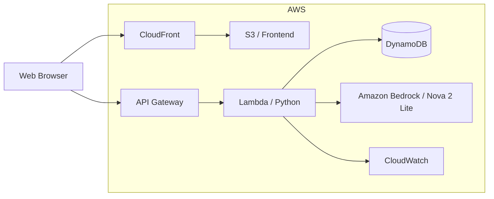

# 理解メモ / Understanding Note

学んだ内容を自分の言葉で説明し、AIからの確認質問に答えることで理解を深める個人学習用Webアプリです。

## コンセプト

1. 自分の言葉で説明を書く
2. AIが理解確認の質問を生成
3. 自分で回答する
4. AIが回答へフィードバック
5. メモ・質問・回答を保存

## Architecture



## 使用技術

- HTML / CSS / JavaScript
- Terraform
- Amazon S3
- Amazon CloudFront
- Amazon API Gateway
- AWS Lambda
- Amazon DynamoDB
- Amazon Bedrock
- Amazon Nova 2 Lite
- Amazon CloudWatch
- AWS Budgets

## デプロイ

```bash
cp terraform/terraform.tfvars.example terraform/terraform.tfvars

terraform -chdir=terraform init
terraform -chdir=terraform validate
terraform -chdir=terraform plan
terraform -chdir=terraform apply

./scripts/deploy_frontend.sh
```

## 削除

```bash
terraform -chdir=terraform destroy
```

## Security

個人学習用MVPです。

- `terraform.tfvars` をGitへ登録しない
- Terraform StateをGitへ登録しない
- AWS認証情報をソースコードへ保存しない
- 顧客情報・認証情報・社内URLなどの機密情報を入力しない
- 現在はユーザー認証を実装していないため、公開サービス用途には追加の認証・認可が必要

## AIモデル

Amazon BedrockのNova 2 Liteを使用しています。

```text
jp.amazon.nova-2-lite-v1:0
```